# speedometer

<p align="center">
  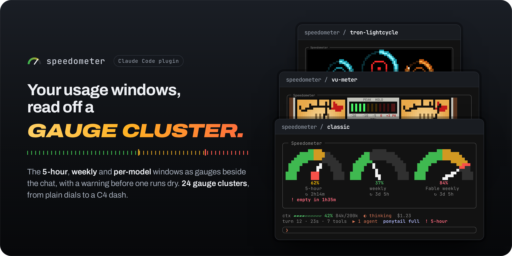
</p>

<p align="center">
  <a href="https://github.com/jameskbb/claude-code-speedometer/actions/workflows/ci.yml"></a>
  <a href=".claude-plugin/plugin.json"></a>
  <a href="LICENSE"></a>
  <a href="#install"></a>
</p>

<p align="center"><b>Your 5-hour, weekly and, if you opt in, per-model usage windows as a gauge cluster beside the chat.</b></p>

<p align="center">
  <a href="#install">Install</a> · <a href="#what-you-see">What you see</a> · <a href="#the-gallery">The gallery</a> · <a href="#burn-rate-warnings">Burn-rate warnings</a> · <a href="#configuration">Configuration</a>
</p>

## Install

At the prompt of a Claude Code terminal session:

```
/plugin install speedometer --marketplace jameskbb/claude-code-speedometer
```

Answer `y` to add the marketplace, then pick a scope. The pane opens on its own once the session has a reading; `/speedometer` reopens it if you closed it. Pick a look under `/config`, row **Gauge cluster**.

## What you see

- **The pane**: three gauges beside the chat, for the 5-hour window, the weekly window and the weekly per-model window (Fable, Opus, whichever your plan scopes), each with its reset time. The per-model gauge has a reading only when **Read per-model limits** is on. Meters fill green, then yellow past 50%, then red past 80%.
- **The band**: one line above the prompt with context usage, an activity badge, session cost, turn stats, running subagents, the [ponytail](https://github.com/DietrichGebert/ponytail) level when that plugin is active for the project, and `! <window>` for each window on course to run out before it resets, whether or not one of the three gauges shows it. The engine's `[-]` collapses it.
- **Warnings**: a window on course to run out before it resets turns red and says when, and a toast warns at 80% and 90% context.

<p align="center">
  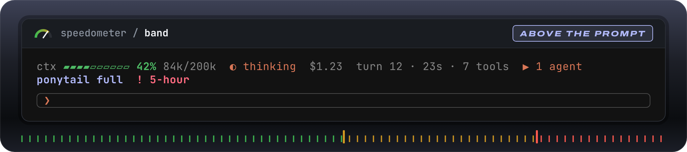
</p>

The 5-hour and weekly windows are the figures Claude Code itself reports. The per-model window comes from the usage endpoint `/usage` reads, and only when you turn on **Read per-model limits** under `/config`; the request uses the session's own sign-in through Claude Code, and the plugin never sees the token.

## What it reads, writes and sends

Everything below is in [`hooks/register.tsx`](hooks/register.tsx); `claude plugin validate .` lists the same calls. The plugin runs no processes and sends no telemetry. By default it makes no network request at all; its one kind of network call, to the usage endpoint, is made only when **Read per-model limits** is on.

### Usage endpoint

This is the plugin's only network request, it goes only to Anthropic, and it is made only when **Read per-model limits** is on under `/config`. That option is off by default: with it off the plugin never asks for the session's sign-in, makes no network request at all, and shows the 5-hour and weekly windows Claude Code itself reports.

- **Where**: `GET https://api.anthropic.com/api/oauth/usage`, Anthropic's own endpoint, the one Claude Code's `/usage` command reads. The request has no body; its only header from the plugin is `anthropic-beta: oauth-2025-04-20`.
- **Credential**: the plugin asks Claude Code for the session's sign-in with `$.session.authorize()` and gets back an opaque handle, not the token. Claude Code adds the credential header itself, over https, and only for Anthropic's own host. The plugin never holds, stores, logs or shows the token. With no Anthropic sign-in (a third-party provider, a gateway, no login) there is no handle and no request is made. Setting `CLAUDE_CODE_DISABLE_NONESSENTIAL_TRAFFIC` makes Claude Code refuse the request.
- **How often**: when the session starts, then at most once a minute as Claude Code reports new usage, counting a failed attempt. A request that has not answered within 5 seconds is abandoned.
- **What is read and kept**: from the response's `limits` list, each window's kind, percent used, reset time and, for the per-model window, the model's display name. These are held in the session's state to draw the gauges. To project burn rate, the plugin also keeps, in its own Claude Code store on this machine, each window's kind and percent with the time they were read, for the past 24 hours (at most 300 readings a window). The rest of the response is discarded.
- **On failure**: the error is dropped without being logged or shown, and the gauges keep their last reading, or the 5-hour and weekly figures Claude Code itself reports.
- **Nothing else leaves the machine**: the plugin sends no data to any other destination, and none of its usage readings are sent anywhere.

### From the session

It reads the session's own figures through the engine: context fill, token counts, cost, the engine's 5-hour and weekly rate-limit readings, the model name, and the start, step and end of turns, tool calls and subagents (type, description, model and token count). These only draw the pane and the band, live in the session's state and are never written to disk or sent anywhere. It reads no prompt, reply or tool content.

### Plugin store (kept across sessions)

One key, `history`: for each rate-limit window, up to 300 samples of a time and a percent used, none older than 24 hours. It is written at most once a minute: from the 5-hour and weekly figures Claude Code reports, or, with **Read per-model limits** on, each time the usage endpoint answers. It is read back to work out the [burn-rate warnings](#burn-rate-warnings). Nothing else is stored.

### Its own settings

It reads the plugin-options block of your Claude Code settings and uses only its own entry. If the saved gauge cluster uses a theme's old name, it saves it once under the new name at session start. It writes no other settings.

### Environment variables

`HOME`, or `USERPROFILE` where `HOME` is unset (Windows), and only to find the ponytail files below. No other variable is read, and none is written.

### Files, for the ponytail integration

The plugin reads and writes no files of its own. It works with two files that the optional [ponytail](https://github.com/DietrichGebert/ponytail) plugin keeps in the `.claude` folder of your home directory:

- **Read** on session start and at the start of each turn: ponytail's flag for this project, `ponytail-modes/<SHA-256 of the project root path>`, to show its level in the band. The project path is hashed on your machine to name the file and goes nowhere else. Without ponytail the file does not exist, the read finds nothing and the band shows no ponytail badge.
- **Written** only when you press the band's ponytail badge, which appears only while ponytail is active: the next level (`lite`, `full` or `ultra`) goes into that project flag and into ponytail's shared `.ponytail-active` file, the same two files ponytail's own `/ponytail` command writes.

### What it adds to the session

Pressing the ponytail badge also appends one line to the conversation, `PONYTAIL MODE CHANGED: level <level>`, so the model follows the new level. Nothing else is ever added to the conversation. The other things it shows are local: the pane, the band, and toasts for 80% and 90% context and for a window on course to run out before it resets.

## The gallery

Pick a cluster under `/config`, row **Gauge cluster**. Every one shows the three windows with their percent, reset time and burn-rate warning; most also fit in context, cost, tool calls or running agents where the original had room for a small gauge. All of them at a glance:

<p align="center">
  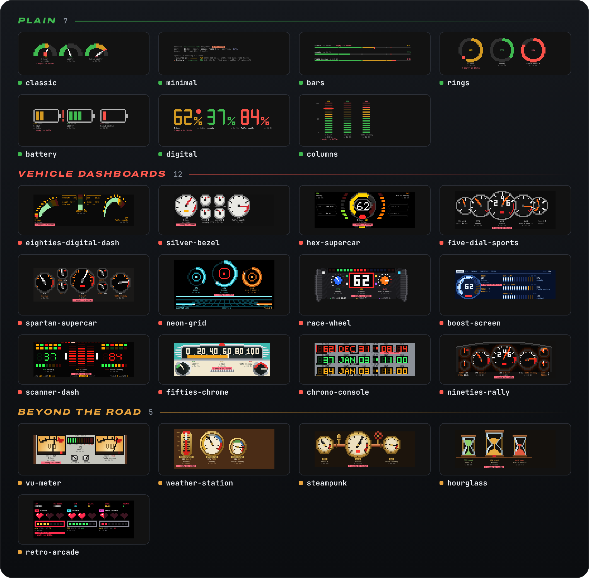
</p>

### Plain (7)

**`classic`** <sub>default</sub>: three equal half-dials with needles.

<p align="center">
  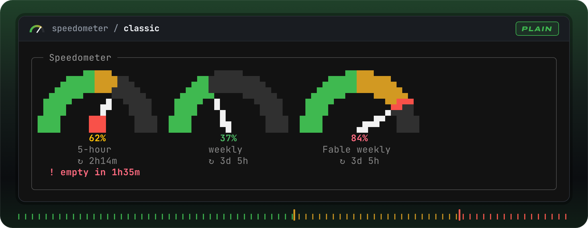
</p>

<details>
<summary>How <code>classic</code> reads your windows</summary>

Three equal half-dials with needles: from left to right the main, second and third gauges (by default the 5-hour window, the weekly window and the model window). Each arc lights green, then yellow past 50% and red past 80%, as far as its reading, with the percent, label and reset time under the dial. A warned dial lights a red hub and prints the time its window runs out.

</details>

**`minimal`**: no gauges, only the facts rows: context, cost, model, turns and agents.

<p align="center">
  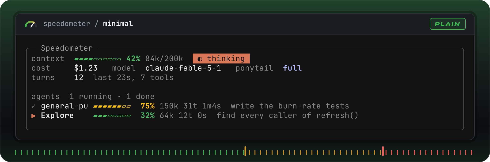
</p>

<details>
<summary>What <code>minimal</code> shows</summary>

No gauges, only the session's facts: context with an activity badge, cost, model, ponytail level, turn stats, and a row per subagent with a bar of its own context fill, its tool calls, its running time and its task (`a` folds them).

</details>

**`bars`**: three wide progress bars, the most reading in the fewest rows.

<p align="center">
  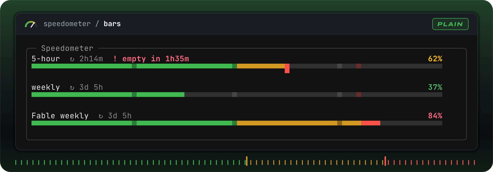
</p>

<details>
<summary>How <code>bars</code> reads your windows</summary>

Three wide progress bars stacked, one per gauge slot, for the most information in the fewest rows. Each gauge shows the source set for its slot under `/config` (by default the 5-hour window, the weekly window and the per-model weekly window) and prints that source's label. Each bar fills left to right over a dim track, turning green, then yellow past 50% and red past 80%, with faint ticks at 25, 50 and 75 and a dim red mark at 80 where red begins. The label, reset time (none for context) and percent sit on one line above each bar; a warned window adds its empty-in time in red and a red cap at the end of its fill.

</details>

**`rings`**: three activity rings, filling clockwise from twelve.

<p align="center">
  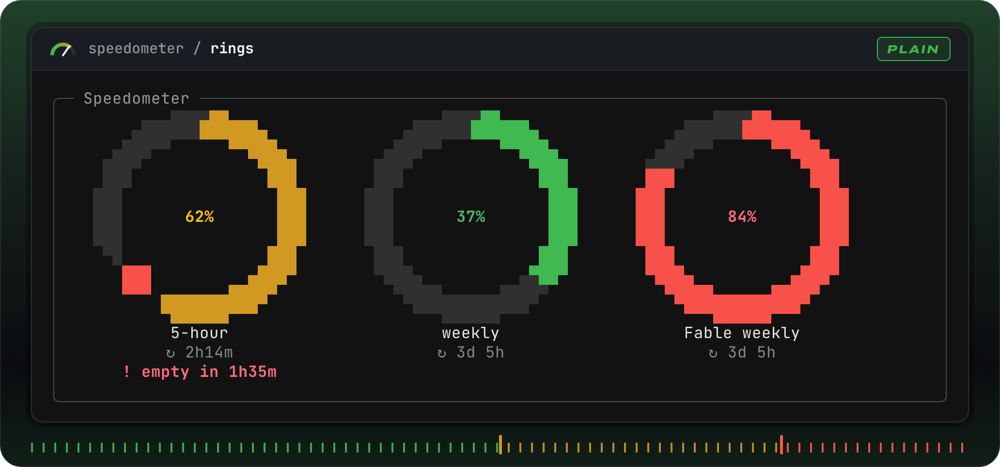
</p>

<details>
<summary>How <code>rings</code> reads your windows</summary>

Three round rings side by side, one per gauge slot, like an activity ring. Each gauge shows the source set for its slot under `/config` (by default the 5-hour window, the weekly window and the per-model weekly window) and prints that source's label. Each fills clockwise from twelve o'clock over a dim track, green, then yellow past 50% and red past 80%, with the percent in the middle of the ring and the label and reset time under it. A warned ring stops short of its head, where a small red bead sits.

</details>

**`battery`**: three batteries that drain as each gauge fills.

<p align="center">
  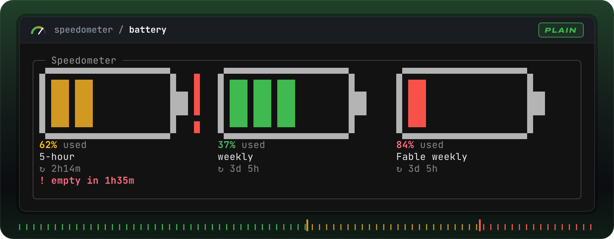
</p>

<details>
<summary>How <code>battery</code> reads your windows</summary>

Three flat battery icons in a row, one per gauge slot, like a status-bar battery scaled up. Each gauge shows the source set for its slot under `/config` (by default the 5-hour window, the weekly window and the per-model weekly window) and prints that source's label. The charge is what is left, so each battery drains as its gauge fills, in five cells that turn from green to yellow to red past 50% and 80% used. Under each battery are its percent used, label and reset time; a warned battery gets a red exclamation mark beside its terminal and an empty-in warning.

</details>

**`digital`**: big seven-segment numbers instead of dials.

<p align="center">
  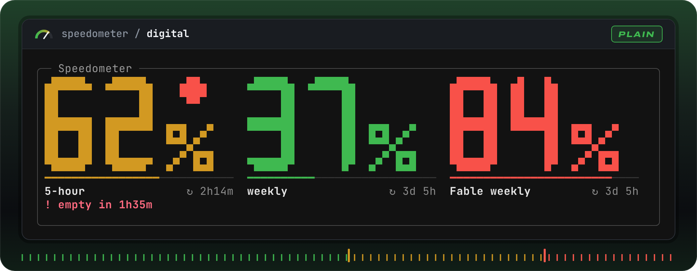
</p>

<details>
<summary>How <code>digital</code> reads your windows</summary>

No dials, three big-number tiles side by side, one per gauge slot. Each gauge shows the source set for its slot under `/config` (by default the 5-hour window, the weekly window and the per-model weekly window) and prints that source's label. Each gauge's percent is drawn in large seven-segment pixel numerals with a small percent sign, coloured by zone, over a thin progress line, with the label and reset on one line beneath. A warned tile gets a red dot above its percent sign and the empty-in warning in red; with no reading it shows dashes.

</details>

**`columns`**: three segmented level columns, like a level meter.

<p align="center">
  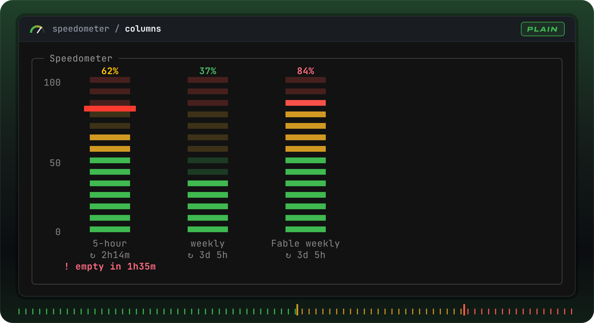
</p>

<details>
<summary>How <code>columns</code> reads your windows</summary>

Three segmented level columns side by side, one per gauge slot, filling from the bottom like a level meter. Each gauge shows the source set for its slot under `/config` (by default the 5-hour window, the weekly window and the per-model weekly window) and prints that source's label. Each segment takes the colour of its height (green to 50%, yellow to 80%, red above) and unlit segments stay as a dim track in the same hue, so the scale always shows. The percent sits above each column, the label and reset under it, and a faint 0/50/100 scale runs beside the first. A warned column gets a bright red bar across its 80% mark.

</details>

### Vehicle dashboards (12)

**`eighties-digital-dash`**: a late-1980s sports car LCD dash: segmented sweeps and amber readouts.

<p align="center">
  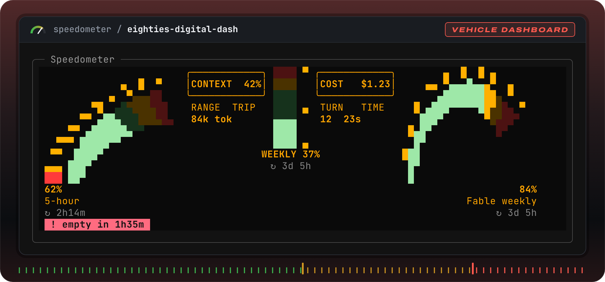
</p>

<details>
<summary>How <code>eighties-digital-dash</code> reads your windows</summary>

Laid out like a late-1980s American sports car LCD dash on a black panel. The main gauge (the 5-hour window by default) is the speedometer sweep on the left and the third (the model window by default) the tachometer arch on the right. The second gauge (the weekly window by default) is the fuel column in the centre between amber context and cost readouts, with its label, percent and reset under it; a warned second gauge adds a red RESERVE lamp with the time it runs out. Unlit segments show dimly, so you can see the scale turn amber then red toward the top.

</details>

**`silver-bezel`**: an early-2000s muscle car cluster: white faces in silver bezels.

<p align="center">
  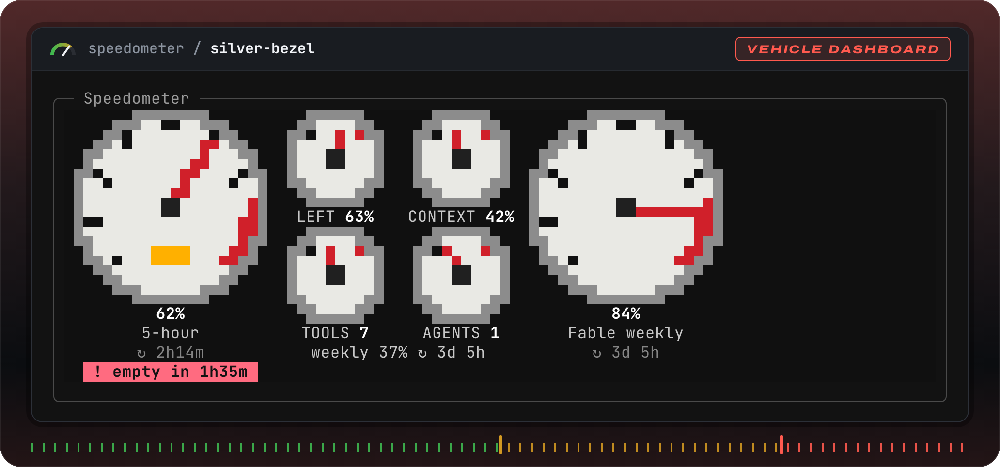
</p>

<details>
<summary>How <code>silver-bezel</code> reads your windows</summary>

After an early-2000s supercharged muscle car cluster: white-faced round gauges in silver bezels with red needles and redline arcs. The main gauge (the 5-hour window by default) is the big gauge on the left and the third (the model window by default) the one on the right. Four small gauges sit between them: LEFT (what is left of the second gauge, the weekly window by default, in the fuel spot, so its needle drops as the window fills), CONTEXT (temp), TOOLS (oil, the last turn's tool calls, full at 20) and AGENTS (boost, running subagents, full at 5). Under them, the second gauge's label, percent used and reset.

</details>

**`hex-supercar`**: an all-digital TFT screen round one big rev display.

<p align="center">
  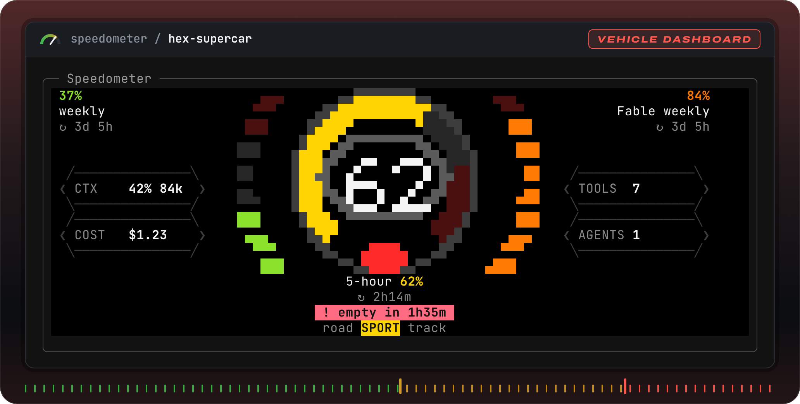
</p>

<details>
<summary>How <code>hex-supercar</code> reads your windows</summary>

After a modern supercar's all-digital TFT screen: black, with one big round rev display in the middle and the reading in digital numerals inside a hexagon. The main gauge (the 5-hour window by default) is the rev display; its lit arc sweeps 270 degrees and turns from green to yellow to orange as the gauge fills, with the last fifth of the scale tinted red. The second gauge (the weekly window by default) is the slim segmented arc bracketing it on the left and the third (the model's weekly window by default) the matching arc on the right, with their readings beside them. Readouts framed as stretched hexagons carry CTX and COST on the left, TOOLS and AGENTS on the right. A drive-mode row under the dial (road, sport, track) lights the mode the main gauge has reached, whatever it shows.

</details>

**`five-dial-sports`**: five overlapping round gauges, the tach biggest and in front.

<p align="center">
  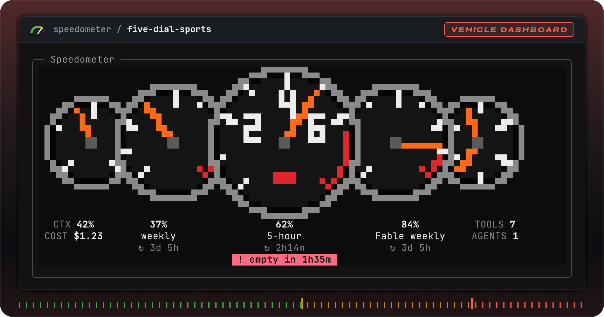
</p>

<details>
<summary>How <code>five-dial-sports</code> reads your windows</summary>

After a classic rear-engined sports car five-gauge dash: five round black-faced gauges in thin silver bezels, each overlapping the next, with white ticks, orange needles and the tachometer biggest and in front in the middle. The main gauge (the 5-hour window by default) is the tach, numbered 2, 4 and 6 with a red band over its last fifth. The second gauge (the weekly window by default) is the one to its left and the third (the model's weekly window by default) the one to its right. The outer two carry context (left, with the cost under it) and a combination gauge (right) with one needle across the top for the last turn's tool calls (full at 20) and one across the bottom for running subagents (full at 5).

</details>

**`spartan-supercar`**: spartan black-faced gauges set into a felt panel.

<p align="center">
  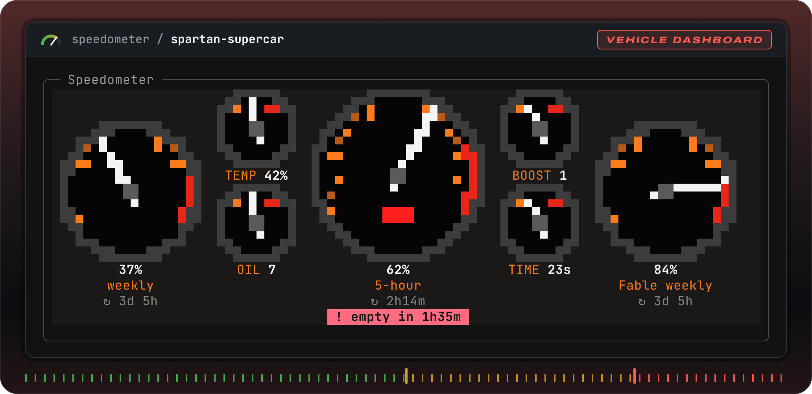
</p>

<details>
<summary>How <code>spartan-supercar</code> reads your windows</summary>

After a late-1980s mid-engined supercar's spartan analogue dash: round black-faced gauges with orange markings, a solid red redline band and white needles, set straight into a dark felt panel. The main gauge (the 5-hour window by default) is the big tachometer in the middle; the second (the weekly window by default) is the speedometer on the left and the third (the model's weekly window by default) the gauge on the right. Four small gauges sit either side of the tach: TEMP (context), OIL (the last turn's tool calls, full at 20), BOOST (running subagents, full at 5) and TIME (the last turn's length, full at two minutes). A warned window lights a red tell-tale lamp low on its face.

</details>

**`neon-grid`**: neon rings on a black void over a perspective grid.

<p align="center">
  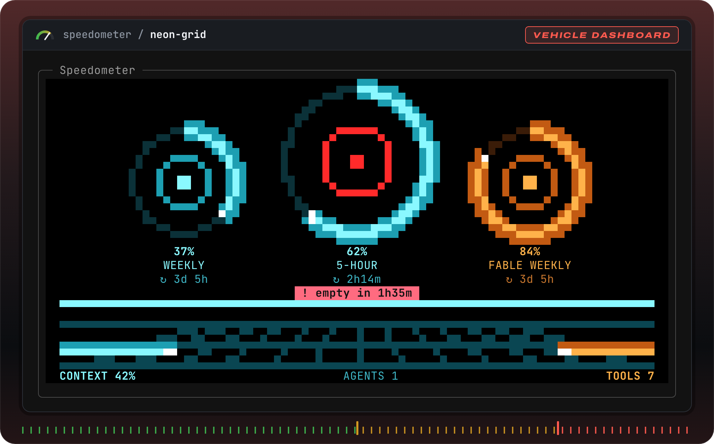
</p>

<details>
<summary>How <code>neon-grid</code> reads your windows</summary>

After the neon look of 1980s computer-world science fiction: a black void, each window a thin glowing neon ring lit clockwise from twelve o'clock to a white-hot head, round an inner circle and hub like a glowing disc. The main gauge (the 5-hour window by default) is the big ring in the middle and the second (the weekly window by default) the cyan ring on the left. The third (the model's weekly window by default) is the orange ring on the right, in a rival's colour. Below them a perspective grid floor runs to a lit horizon, and two light trails race in from either side: cyan for context and orange for the last turn's tool calls (full at 20), with running agents counted between them. A warned window turns its ring's inner circle and hub red.

</details>

**`race-wheel`**: a steering wheel with fifteen shift lights and two rotaries.

<p align="center">
  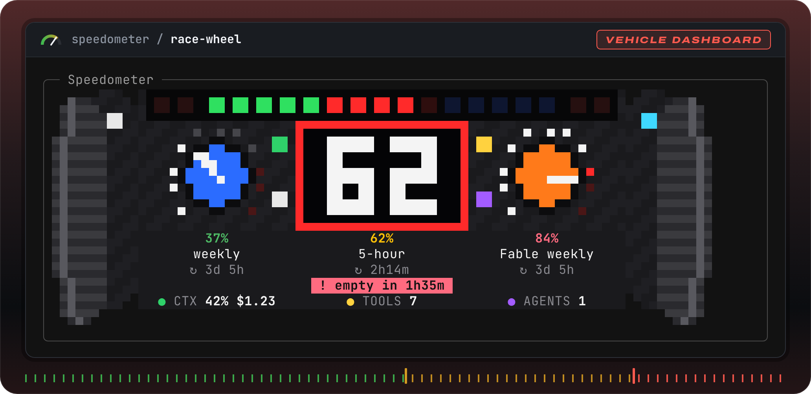
</p>

<details>
<summary>How <code>race-wheel</code> reads your windows</summary>

After a modern single-seater racing steering wheel seen face on: a carbon-fibre body between two ridged rubber grips, with a black strip of fifteen shift lights across the top. The main gauge (the 5-hour window by default) fills the shift lights left to right, five green, then five red, then five blue, and shows its percent in big gear-style digits on the small LCD in the middle. A warned main gauge rings the LCD in red. The second gauge (the weekly window by default) is the blue rotary on the left and the third (the model's weekly window by default) the orange rotary on the right. Each rotary has a white pointer and eleven position dots that light up to its reading, the last two in red. A warned rotary gets a red rim, and a pair of flag lights at its end of the strip glows red. Coloured buttons beside the LCD carry CTX (context, with the cost), TOOLS (the last turn's tool calls) and AGENTS (running subagents), with their readings printed under the gauges.

</details>

**`boost-screen`**: a navy multifunction screen of segmented graphs.

<p align="center">
  
</p>

<details>
<summary>How <code>boost-screen</code> reads your windows</summary>

After a late-1990s Japanese turbo coupe's centre multifunction display: a dark navy screen with a strip of page tabs across the top, segmented graphs lit blue-white with an amber top end, and a digital readout beside each. The 5-hour window is the round boost gauge on the left, its reading in digits in the middle and its percent, reset and running TOOLS and AGENTS counts beside it. On the right, the weekly window is the OIL TEMP bar graph, the model window the INTAKE TEMP bar graph, and context the THROTTLE bar graph under them, each with its percent and label beside the bar. The last turn's time reads as a LAP timer in the tab strip. A warned window lights a red lamp: in the open bottom of the boost gauge, or at the end of its bar.

</details>

**`scanner-dash`**: a sci-fi car's red voice display and scanner.

<p align="center">
  
</p>

<details>
<summary>How <code>scanner-dash</code> reads your windows</summary>

After a talking car's dash from 1980s science fiction: a black panel with a red scanner light across the top and the red voice display in the middle. The 5-hour window is the voice display, three columns of red bars that grow outward from the centre line as the window fills, the middle column reaching furthest. The weekly window is the bank on the left and the model window the bank on the right. Each bank has a row of small lit square buttons, a three-digit segmented readout of its percent and an LED bar graph that runs green, then amber from 50% and red from 80%. The scanner's bright eye sits at the context fill. Each bank's second row of buttons counts something: the last turn's tool calls on the left, running subagents on the right. Under the voice display, STANDBY, CRUISE and ALERT light by how full the 5-hour window is, between CTX and COST on the left and TOOLS and AGENTS on the right. A warned window flashes a white lamp beside its display.

</details>

**`fifties-chrome`**: a two-tone dash with a ribbon speedometer under chrome.

<p align="center">
  
</p>

<details>
<summary>How <code>fifties-chrome</code> reads your windows</summary>

After the late-1950s two-tone dash: a turquoise upper dash with a chrome hood arching over a long curved glass window, chrome fins either side, and an ivory lower dash. The 5-hour window is the ribbon speedometer across the top: a band slides left to right along a strip under the numbers 0 to 100, green, then amber from 50% and red from 80%, with a bright leading edge. The weekly window is the small chrome-ringed gauge on the left of the lower dash and the model window the one on the right, each with its own lit arc and ivory needle. The 5-hour readings sit between them over a strip of chrome ribbing. A warned window lights a red jewel in the top of the hood (for the 5-hour window) or a red lamp low on its gauge face.

</details>

**`chrono-console`**: three rows of segment displays that read out when each window resets.

<p align="center">
  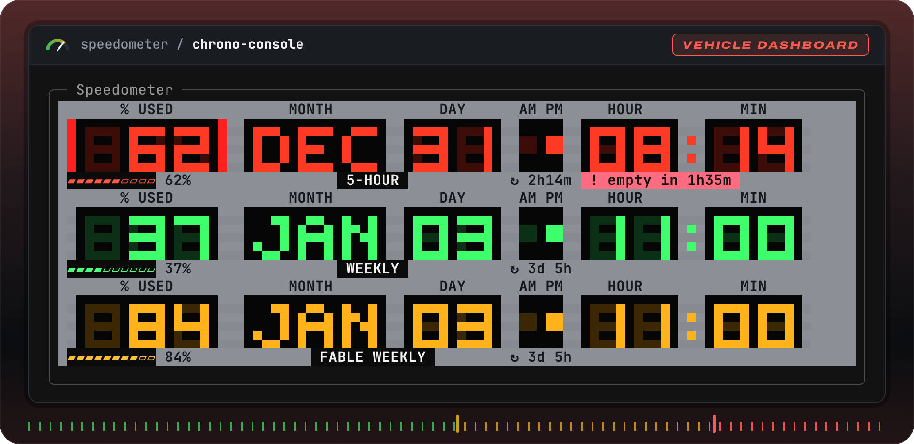
</p>

<details>
<summary>How <code>chrono-console</code> reads your windows</summary>

After a 1980s science-fiction time-travel console in a stainless steel car: three stacked rows of chunky segment displays in a brushed-steel housing, each with small engraved windows and a black label plate under it. The 5-hour window is the red top row, the weekly window the green middle row and the model window the amber bottom row. Each row reads its percent used in big segment digits, then the moment the window resets as MONTH, DAY, an AM or PM lamp, HOUR and MIN, with unlit segments glowing faintly behind the lit ones. A small bar on the plate line shows the fill, and a warned row lights red bars either side of its percent window.

</details>

**`nineties-rally`**: black-faced gauges in an orange night glow under a hood.

<p align="center">
  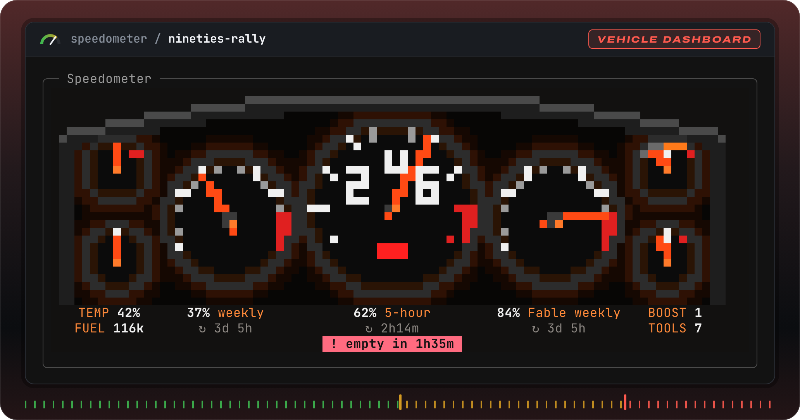
</p>

<details>
<summary>How <code>nineties-rally</code> reads your windows</summary>

After a 1990s rally-bred turbo saloon's cluster: a black hooded binnacle over black-faced gauges with crisp white markings, orange-red needles and red redline arcs, in the orange glow their backlights gave off at night. The 5-hour window is the big tachometer in the middle, numbered 2, 4 and 6 with its red arc from 7. The weekly window is the speedometer on the left and the model window the second main gauge on the right. Small gauges sit at the outer edges: TEMP (context) over FUEL (context tokens left) on the left, and on the right BOOST (running subagents, full at 5, on a vacuum-to-boost scale) over TOOLS (the last turn's tool calls, full at 20). A warned window lights a red lamp low on its face.

</details>

### Beyond the road (5)

**`vu-meter`**: amber-lit hi-fi VU meters between walnut cheeks.

<p align="center">
  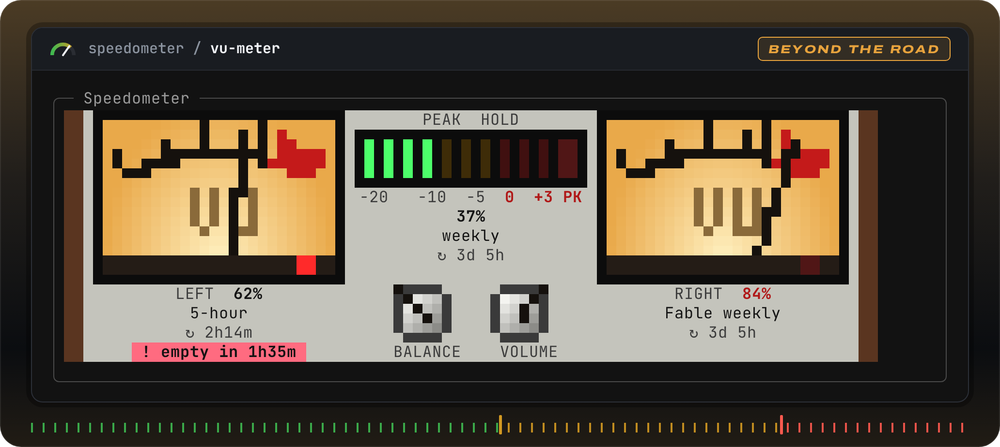
</p>

<details>
<summary>How <code>vu-meter</code> reads your windows</summary>

After the backlit VU meters on a 1970s hi-fi amplifier: two amber-lit windows in a brushed-aluminium faceplate between walnut cheeks. Each has a black needle swinging up from a covered pivot over a scale that turns red at 0 VU, and a small red peak LED that lights when the gauge is warned. The main gauge (the 5-hour window by default) is the left channel and the third gauge (the model weekly window by default) the right. Between them, the second gauge (the weekly window by default) is a peak-hold LED ladder (green, then amber from 50%, red from 80%) above BALANCE and VOLUME knobs. Each prints its percent, the label of what it shows, and its reset when it has one. A meter with no reading has its lamp off.

</details>

**`weather-station`**: brass instruments on a walnut panel.

<p align="center">
  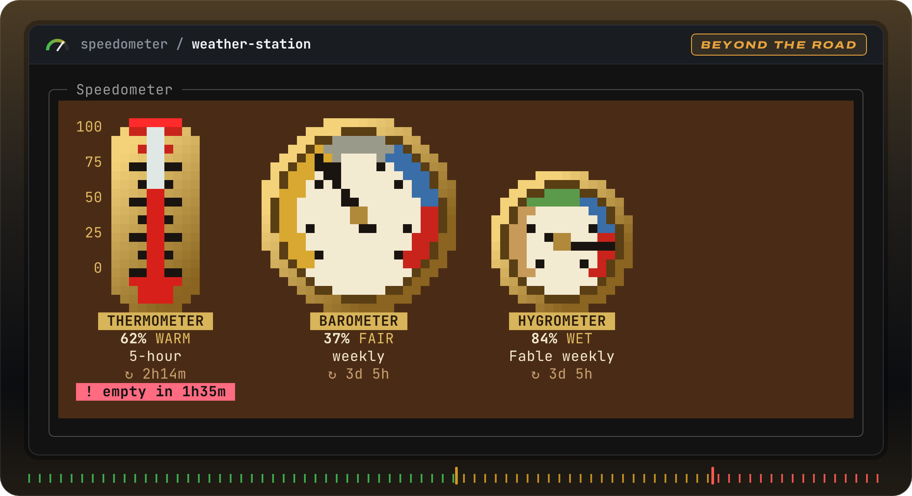
</p>

<details>
<summary>How <code>weather-station</code> reads your windows</summary>

After a brass-and-wood home weather station: three brass instruments on a walnut panel, each over a brass name plate. The main gauge (the 5-hour window by default) is the thermometer on the left: a glass tube on a brass plate with a red column rising from the bulb, scaled 0 to 100 (COLD to HOT). The second gauge (the weekly window by default) is the big barometer in the middle, its face banded FAIR, CHANGE, RAIN and STORMY. The third gauge (the model weekly window by default) is the hygrometer on the right, reading DRY, COMFORT, DAMP and WET. Under each name plate are the percent and its weather word, then the label of what the gauge shows. The dials have paper faces in polished brass bezels, black needles and a red zone from 80%; a warned gauge shows a red mark on its instrument.

</details>

**`steampunk`**: brass boiler gauges joined by copper pipes.

<p align="center">
  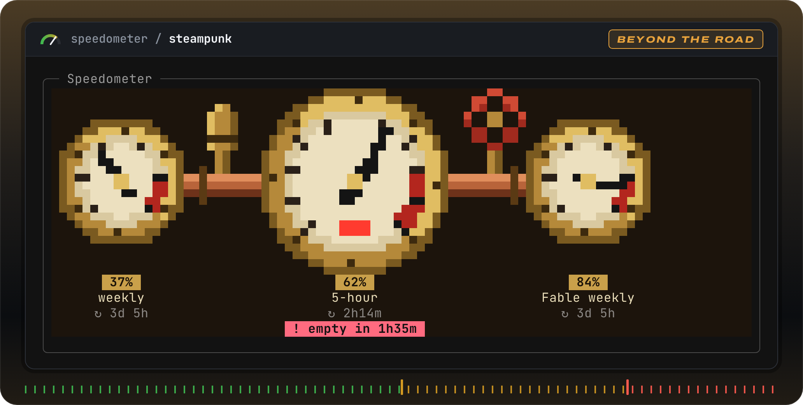
</p>

<details>
<summary>How <code>steampunk</code> reads your windows</summary>

After the brass pressure gauges on a Victorian boiler: cream faces in riveted brass bezels, black needles with a counterweight tail, a red danger sector at the top of each scale, and copper pipes joining the three. The main gauge (the 5-hour window by default) is the big boiler gauge in the middle. The second gauge (the weekly window by default) hangs off the left pipe under a brass steam whistle, which lets off steam once its needle reaches the danger sector. The third gauge (the model weekly window by default) hangs off the right pipe under a red valve wheel. Each gauge reads its percent on a brass plate over the label of what it shows, and a warned gauge lights a red lamp low on its face.

</details>

**`hourglass`**: three sand glasses; the sand left is what each gauge has left.

<p align="center">
  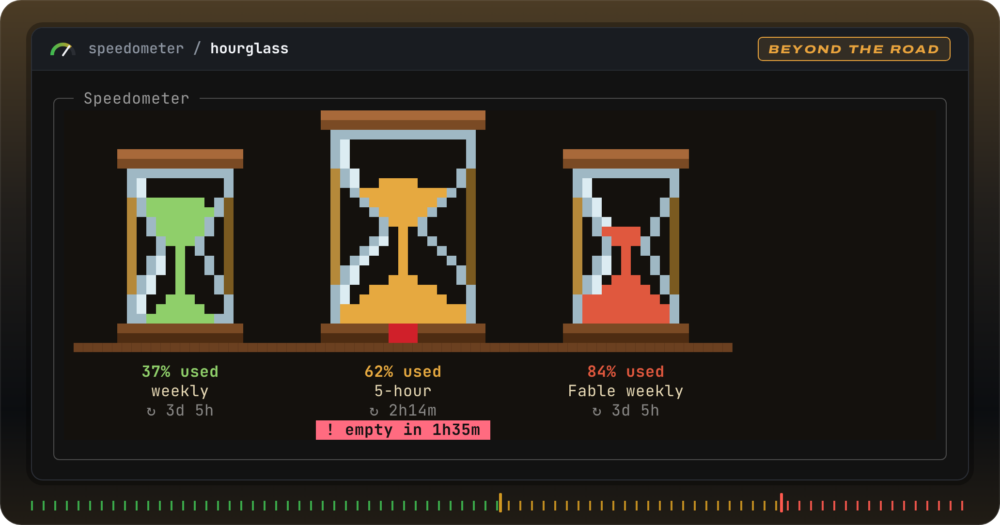
</p>

<details>
<summary>How <code>hourglass</code> reads your windows</summary>

Three sand glasses with wooden caps and brass posts, standing on a wooden shelf. Sand left in the top bulb is what the gauge has left; the pile in the bottom bulb is what has been used, with a thin stream falling between them while the gauge is part used. The sand turns from green to amber to red as the gauge passes 50% and 80%, and a warned glass wears a red seal on its base. The main gauge (the 5-hour window by default) is the tall glass in the middle, the second gauge (the weekly window by default) the one on the left and the third gauge (the model weekly window by default) the one on the right, each labelled with what it shows.

</details>

**`retro-arcade`**: an 8-bit heads-up display where each gauge is your health.

<p align="center">
  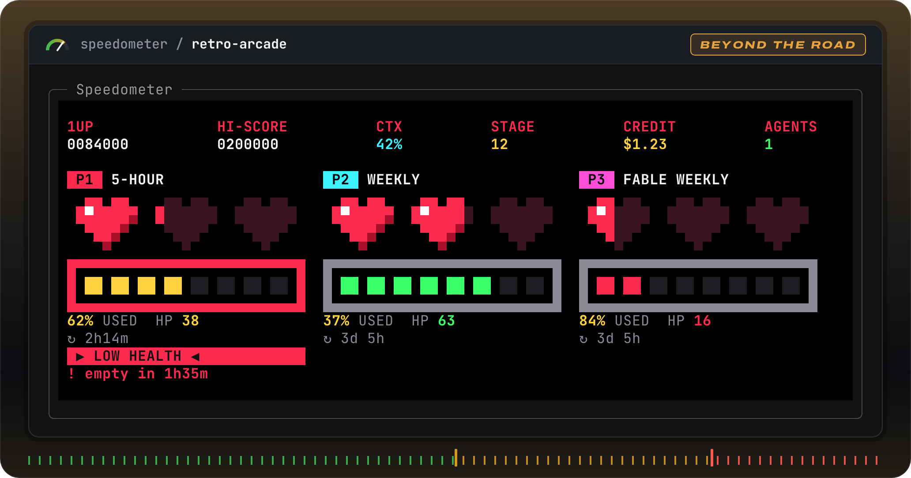
</p>

<details>
<summary>How <code>retro-arcade</code> reads your windows</summary>

After an 8-bit arcade heads-up display on a CRT: a black screen, a score line across the top, and one player card per gauge, headed by the label of what it shows. P1 on the left is the main gauge (the 5-hour window by default), P2 in the middle the second gauge (the weekly window by default) and P3 on the right the third gauge (the model weekly window by default). Each card has three pixel hearts over a segmented health bar, and what is left of the gauge is your health, so both empty as it is used; the bar turns from green to yellow to red as health runs low. A warned gauge rings its bar in red and flashes LOW HEALTH over its empty-in time, a spent one reads GAME OVER, and one with no reading yet (a context gauge before the first turn included) says INSERT COIN. Along the top, 1UP is the context tokens, HI-SCORE the context window, CTX the context percent, STAGE the turn count, CREDIT the cost and AGENTS the running subagents.

</details>

## Burn-rate warnings

Each window's recent slope is projected to its reset. If it hits 100% first, that dial lights a red hub, its label line turns red with the time it runs out, and the band shows `! <window>`. By default the slope counts every hour, so the warning simply says whether you run out before the reset. To count only a work week, turn **Count every hour** off under `/config` and set **Work day starts**, **Work day ends** and **Count weekends**; equal start and end counts every hour.

## Configuration

Under `/config`:

| Row | Default | What it does |
|---|---|---|
| **Gauge cluster** | `classic` | The look of the pane: any id from [the gallery](#the-gallery). |
| **Main gauge** | `auto` | What the main gauge shows: `five-hour`, `weekly`, `model-weekly` or `context` (context window fill). `auto` shows the 5-hour window, or the weekly window on a plan with no 5-hour limit. |
| **Second gauge** | `auto` | The same choices. `auto` shows the weekly window, or context fill on a plan with no 5-hour limit. |
| **Third gauge** | `auto` | The same choices. `auto` shows the per-model weekly window, which needs **Read per-model limits** on. |
| **Read per-model limits** | off | Ask the usage endpoint `GET https://api.anthropic.com/api/oauth/usage`, at most once a minute, for the per-model weekly window, using the session's own sign-in through Claude Code; the plugin never sees the token. Off: no network request is made, and only the 5-hour and weekly windows Claude Code reports are shown. See [Usage endpoint](#usage-endpoint). |
| **Count every hour** | on | Project burn rate over every hour of every day. Off: only the work day set below, Monday to Friday unless **Count weekends** is on. |
| **Work day starts** | `08:00` | Used only when **Count every hour** is off. HH:MM local; equal start and end counts every hour. |
| **Work day ends** | `17:00` | Used only when **Count every hour** is off. HH:MM local. |
| **Count weekends** | off | Used only when **Count every hour** is off: count Saturday and Sunday. |

Upgrading from 0.6 or earlier: the per-model window used to be read by default. From 0.7.0 it needs **Read per-model limits** turned on; until then the third gauge shows no reading.

## Development

```
claude plugin validate .
claude plugin test .
scripts/check.sh
```

`scripts/check.sh` runs both, a public-safety scan, and a check that the README lists every cluster under its category. A new cluster is a `ThemeDef` in its own file under `hooks/themes/` (importing only from `kit.tsx`), a line in `hooks/themes/index.ts`, an option in `.claude-plugin/plugin.json`, a `tests/theme-<id>.test.tsx`, and an entry in the gallery. Clusters draw only their gauges, and evoke the original through layout, shape and colour rather than logos or wordmarks.

Vehicle, film and series names are trademarks of their owners and are used only to say which dashboard a cluster is modelled on. This project is not affiliated with or endorsed by any of them.

## Privacy

The plugin collects nothing for its developer and sends no telemetry. [PRIVACY.md](PRIVACY.md) is the privacy policy: what it reads, what it keeps on your machine and for how long, and how to delete it.

## Support

Report bugs and ask questions in [GitHub Issues](https://github.com/jameskbb/claude-code-speedometer/issues); see [SUPPORT.md](SUPPORT.md). Report security problems privately as [SECURITY.md](SECURITY.md) describes.

## License

MIT
